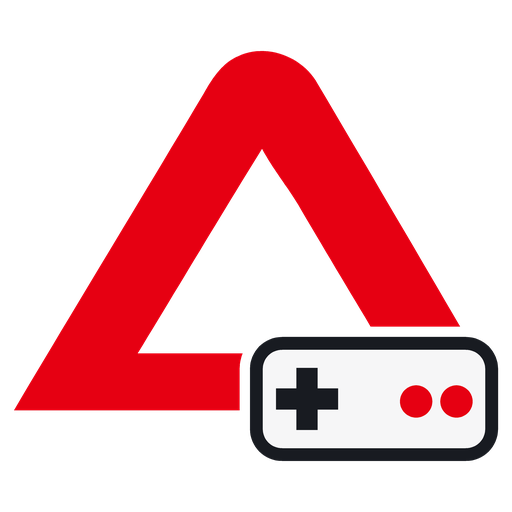
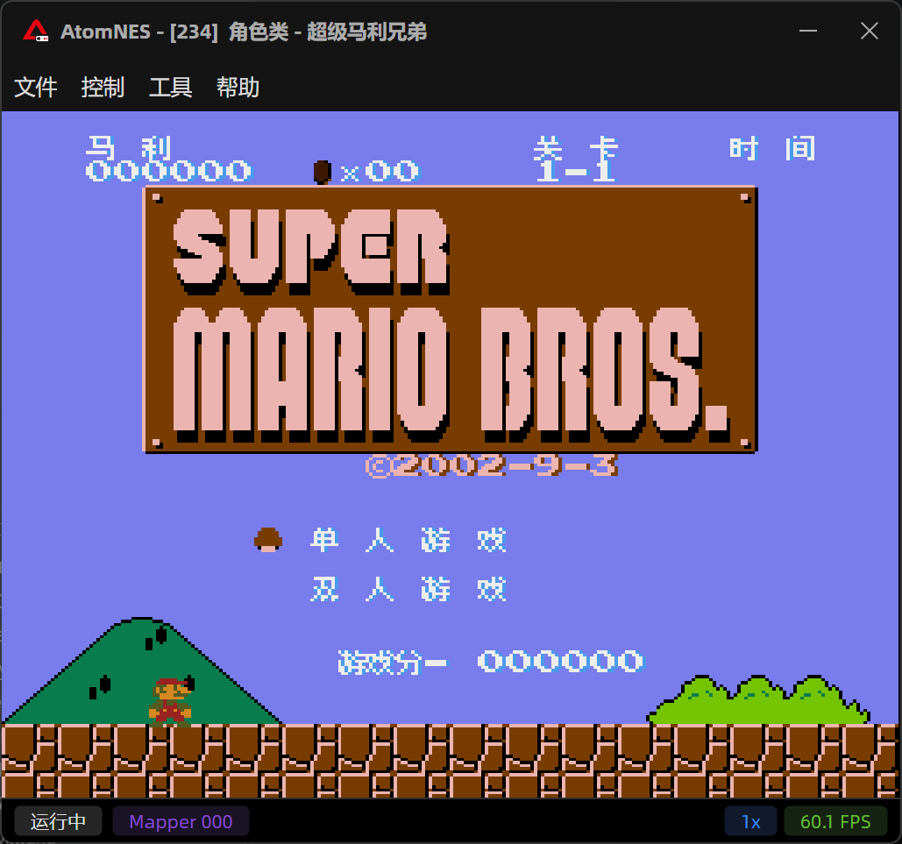
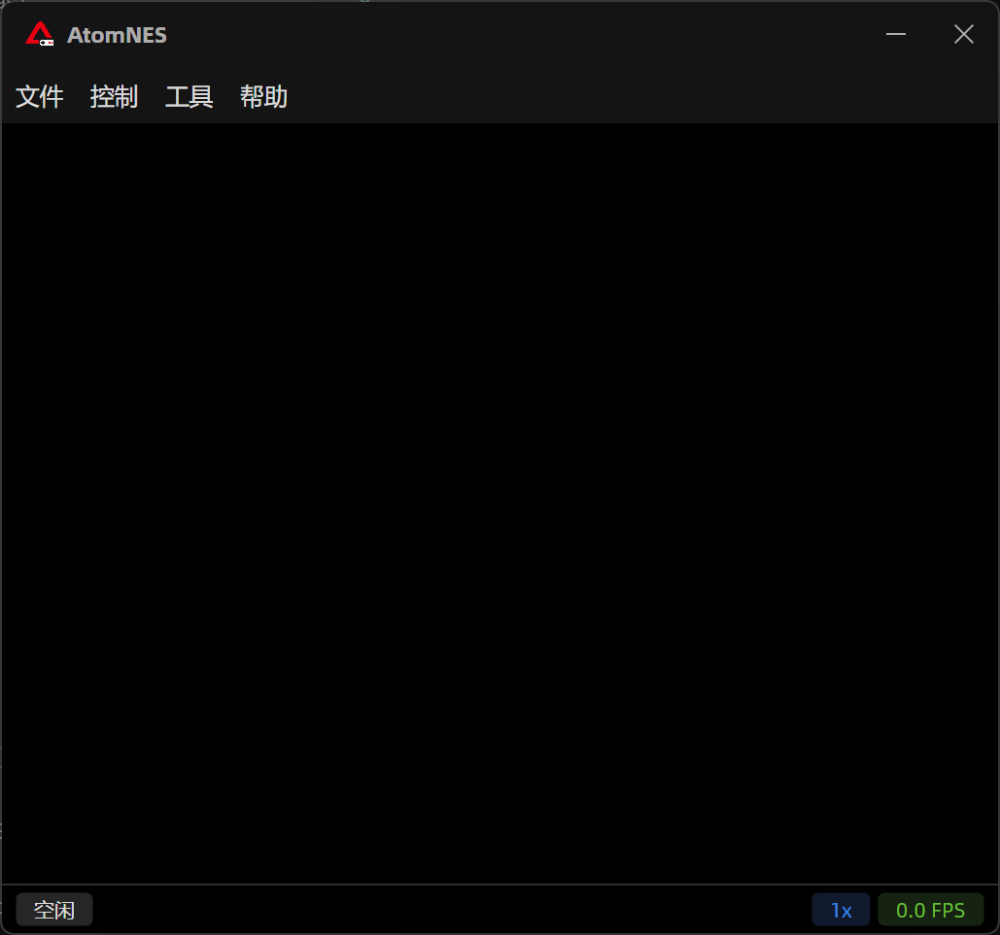

<div align="center">



# AtomNES

**A cycle-accurate, cross-platform NES / Famicom emulator built with Avalonia and AtomUI.**

[简体中文](README.zh-CN.md) · English


<br />



</div>

AtomNES is a desktop NES (Famicom) emulator for Windows and Linux. The emulation core has no UI dependency; it runs the 6502 CPU cycle by cycle and the PPU dot by dot. The UI is built entirely from AtomUI components.

## Features

- **Cycle-accurate core.** 6502 CPU stepped per cycle (including dummy reads/writes and DMA stalls), PPU rendered per dot, and the 2A03 APU with band-limited synthesis and analog filtering.
- **106 mapper IDs.** Covers the vast majority of officially released games plus many Chinese-market and multicart boards (Waixing, Nanjing, JY Company, FK23C and others).
- **Expansion audio.** VRC6, VRC7 (FM synthesis via an emu2413 port), Namco 163, Sunsoft 5B and MMC5 sound.
- **Battery saves.** Battery-backed PRG RAM is saved to a `.sav` file next to the ROM.
- **Debugger.** CPU registers, disassembly, pattern tables, palette RAM, PPU state and nametables.
- **Configurable keys** for two controllers, plus volume control.
- **Chinese and English UI.** Switch languages from the Help menu. The theme follows the system on startup.
- **NativeAOT and trimmed self-contained publish.**

## Screenshots

<table>
  <tr>
    <td width="50%"><br /><sub><b>Main window.</b> Open a ROM with Ctrl+O or pass it on the command line.</sub></td>
    <td width="50%"><br /><sub><b>Gameplay.</b> Pixel-exact output scaled to the window.</sub></td>
  </tr>
</table>

## Architecture

```
AtomNES (Avalonia + AtomUI UI, SDL3 audio)
   │
   └──▶ AtomNES.Device   CPU · PPU · APU · Bus · Cartridges/Mappers
              ▲
   AtomNES.Device.Tests  xUnit + authoritative test ROMs
```

| Project | Responsibility |
|---|---|
| `AtomNES.Device` | Emulation core: cycle-accurate 6502, dot-based 2C02 PPU, 2A03 APU, expansion audio, mappers |
| `AtomNES.Device.Tests` | Tests driven by nestest, blargg, Holy Mapperel, mmc3_test and other public test ROMs |
| `AtomNES` | Desktop app: main window, debugger, key mapping, localization, SDL3 audio output |
| `Docs` | Notes on the [CPU](Docs/CPU.md), [PPU](Docs/PPU.md), [APU](Docs/APU.md) and [mapper coverage](Docs/Mappers.md) |

## Getting started

### Prerequisites

- [.NET 10 SDK](https://dotnet.microsoft.com/download/dotnet/10.0)
- NativeAOT publishing also needs the platform C toolchain (MSVC on Windows; `clang` and `zlib1g-dev` on Linux).

### Build and run

```bash
dotnet build AtomNES
dotnet run --project AtomNES -- path/to/game.nes
```

### Run the tests

```bash
dotnet test AtomNES.Device.Tests
```

### Publish

```bash
# Self-contained, trimmed single file
dotnet publish AtomNES -c Release -r win-x64 --self-contained -p:PublishSingleFile=true -p:PublishTrimmed=true
# NativeAOT (build on the target OS)
dotnet publish AtomNES -c Release -r linux-x64 -p:PublishAot=true
```

> A NativeAOT binary built on Linux depends on the build machine's glibc version.

## Default controls

| NES | Player 1 | Player 2 |
|---|---|---|
| D-pad | W A S D | Arrow keys |
| A / B | K / J | Num 2 / Num 1 |
| Select / Start | Right Ctrl / Enter | Num + / Num − |

Hotkeys: `Ctrl+O` open ROM · `F5` pause · `F2` reset · `F8` debugger · `F1` key mapping.

## Acknowledgements

- [AtomUI](https://github.com/AtomUI/AtomUI) and [Avalonia](https://avaloniaui.net/)
- [Mesen2](https://github.com/SourMesen/Mesen2), the reference for many mapper implementations
- [emu2413](https://github.com/digital-sound-antiques/emu2413) by Mitsutaka Okazaki (MIT), used for VRC7 audio
- The NESdev community and the authors of the test ROMs

## License

[MIT](LICENSE). AtomNES does not include any commercial game ROMs. Use only ROMs you are legally allowed to use.
